# PolyGate student walkthrough (English)

[中文版](PolyGate_学生全流程图文指南_ZH.md) · [Sample source code](../examples/polygate-mock-projects/README.md)

This guide follows a real **Python ZIP → build → approved image → running app → stop → delete** browser session. The screenshots were captured from the live laboratory pilot on 9 November 2026 at 1366 × 768. Sample app names and dates in your account will differ. The platform interface is in English. No cloud model API key is needed for this walkthrough.

## Before you start

- Use a current desktop browser. Open **<https://polygate.polylink.org/>**. The old laboratory entry **<https://YOUR-POLYGATE-HOST/>** remains available for fallback.
- Have the username and initial password supplied by the laboratory operator. Do not use someone else's account.
- The public URL uses a browser-trusted HTTPS certificate. The old laboratory IP entry uses a self-signed certificate; confirm that exact IP and port before accepting its warning.
- A new account may first be asked to change its temporary password. Finish that Keycloak screen, then continue to the workspace. The screenshots below use an account whose password was already changed.
- The sign-in form stays in the readable PolyGate light palette even when your browser uses dark mode.

## Follow the complete ZIP workflow

### Step 1 — Open PolyGate and sign in

You should see **Welcome to PolyGate**. Select **Sign in**. On the next page, fill **Username** and **Password**, then select **Sign In**. If the browser returns to a sign-in form, check the credentials or ask the operator to reset your password.

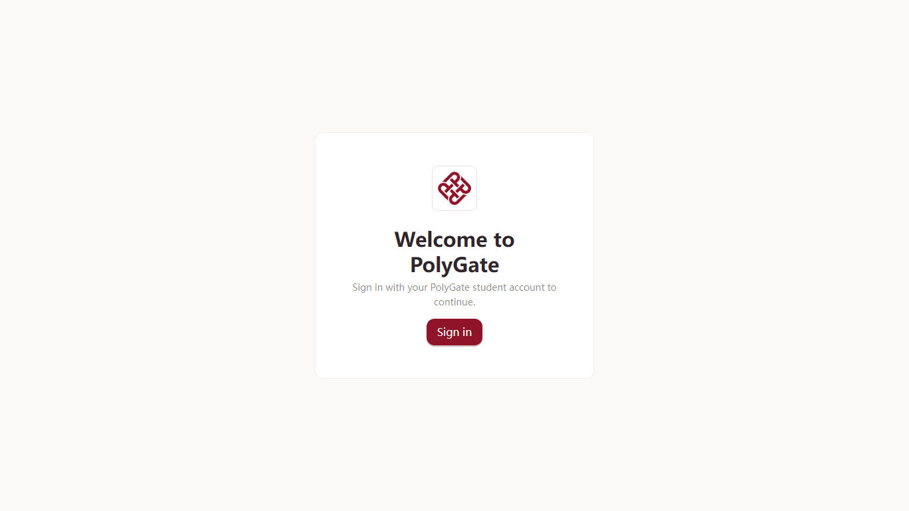

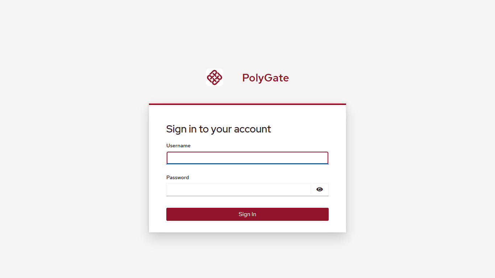

### Step 2 — Check the workspace

The **Overview** page says **Your workspace** and shows your configured resource quota. A draft or stopped app also counts toward that configured quota. The left navigation contains **Help**, **Source ZIP**, **My images**, **Volumes**, and other pages. Your account may allow at most two apps; the exact remaining amount is shown on your own screen.

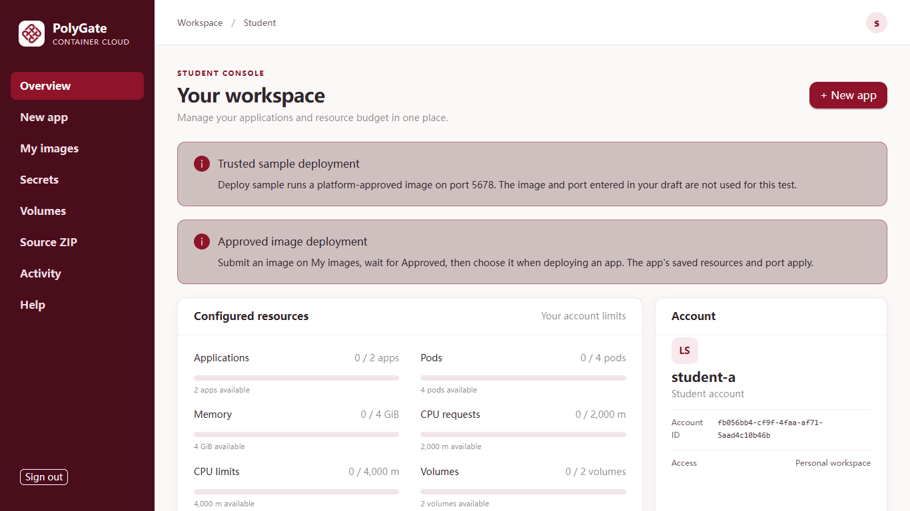

### Step 3 — Download a sample ZIP

Select **Help** in the left navigation. Under **Download a sample project**, select **Mock Agent (Python ZIP)**. The browser downloads `mock-agent-python.zip`. Keep the ZIP intact; do not extract it before uploading. The other two examples are a Node.js counter and a Dockerfile based request inspector. Their build methods and ports are listed on the same Help card.

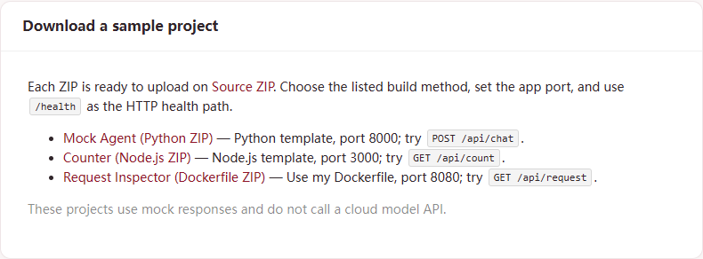

### Step 4 — Choose the matching build method

Select **Source ZIP** in the left navigation. In **Build method**, choose **Python template**. This example listens on `0.0.0.0:8000`; the `main.py` file is at the ZIP root. For the other examples, follow the build method and port table near the end of this guide.

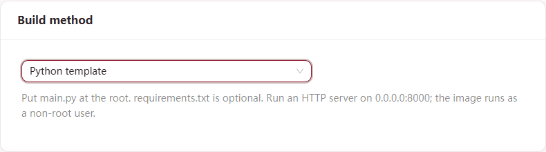

### Step 5 — Select and submit the ZIP

Select **Browse ZIP...**, choose the downloaded `mock-agent-python.zip`, and check that **Selected: mock-agent-python.zip** appears. Select **Queue build** once. The button accepts ZIPs up to 100 MiB compressed and 1 GiB expanded. Do not reload the page while the upload is being submitted.

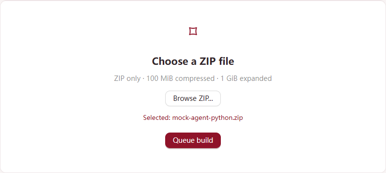

### Step 6 — Watch the build

In **Build history**, the newest row starts at **Queued**, may show **Building**, and should become **Succeeded**. The page refreshes automatically; **Refresh** is available if needed. The screenshot also shows older test rows: use the newest row and its submission time, rather than an older successful build.

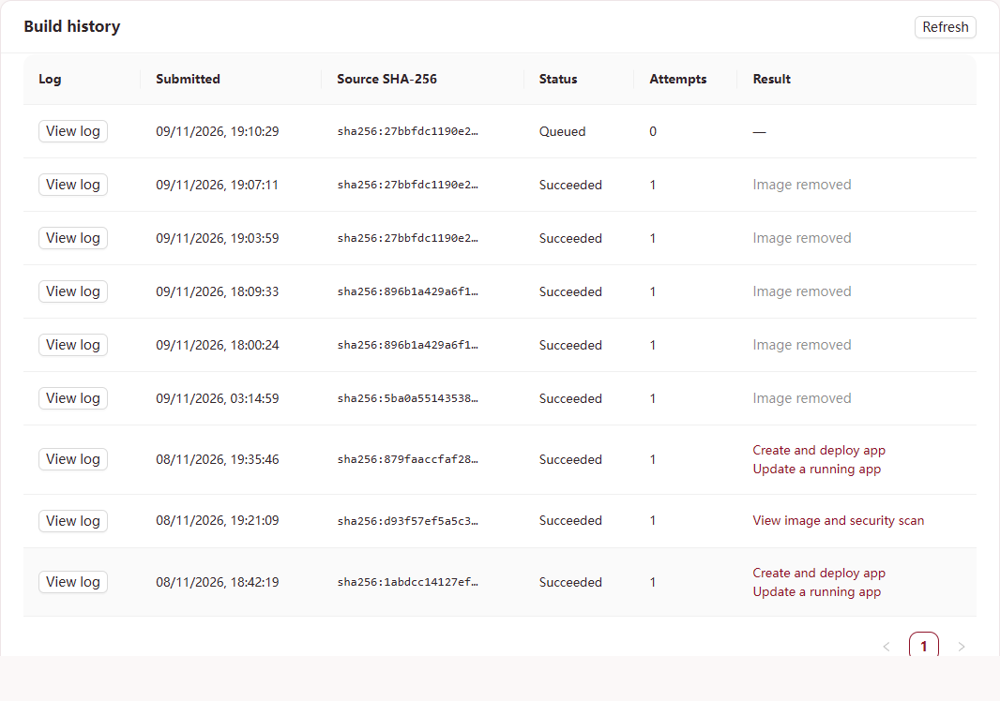

Select **View log** on that row to read the build output. If the build fails, the log is the first place to look. A successful build is followed by an image security scan; wait until the result shows **Create and deploy app**. If it only says **View image and security scan**, open **My images** and wait for **Approved**. A rejected image cannot be deployed.

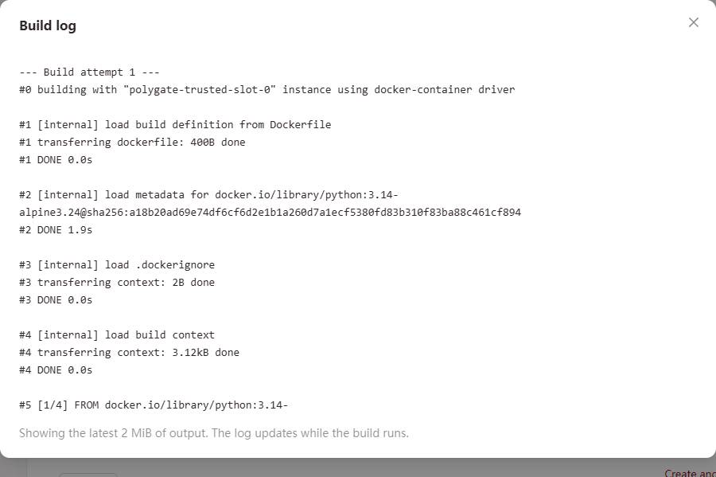

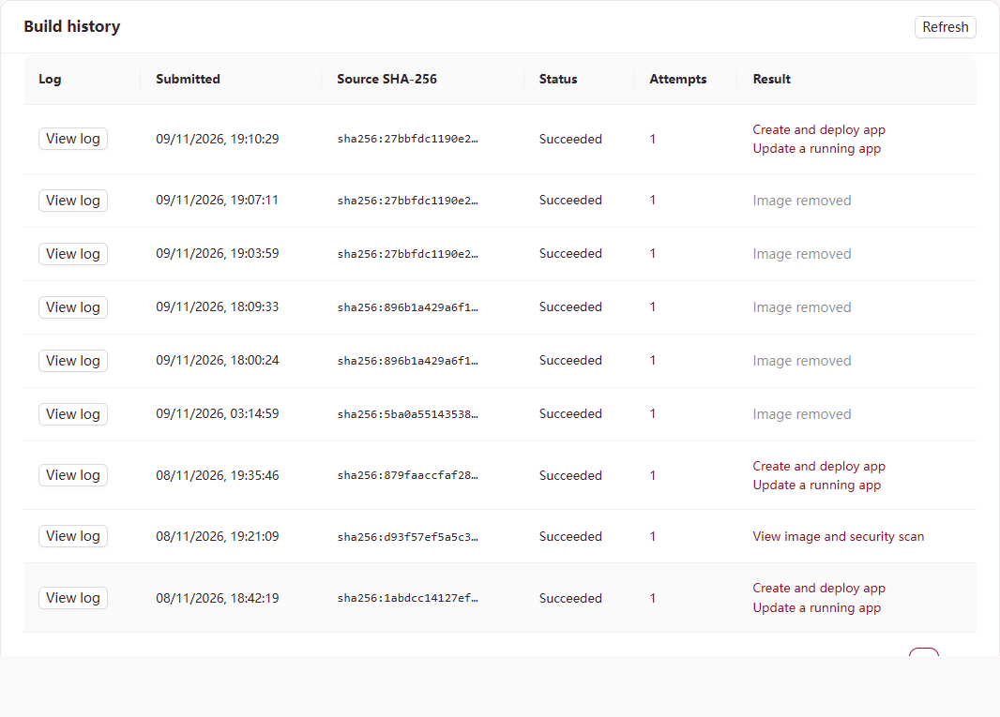

### Step 7 — Configure and deploy the app

Select **Create and deploy app** on your successful build row. The next page says **Approved build selected**. Fill a unique lowercase **App name**, for example `my-mock-agent`. Leave the selected image reference as supplied by PolyGate. Set **App port** to `8000` and **HTTP health path** to `/health`.

**App port is the port inside the container where your HTTP server actually listens.** For this Python sample it is `8000`. Enter the number only: do not enter a URL, the browser's HTTPS port, or a host port. Your program must bind to `0.0.0.0` on that port; binding only to `127.0.0.1` makes it unreachable from PolyGate. `/health` is available in this sample, but **HTTP health path** is optional for your own app. Leave it blank if you do not have an endpoint that returns HTTP 2xx or 3xx while healthy.

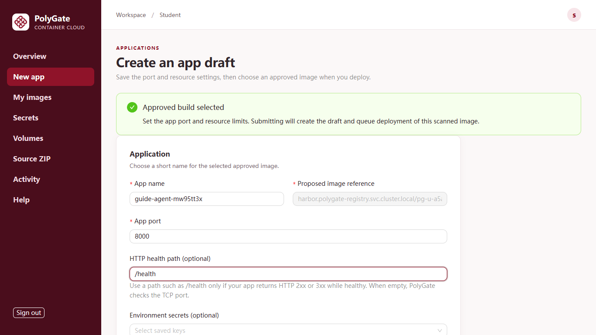

For a first test, leave **CPU request** at `250 m`, **CPU limit** at `1000 m`, **Memory** at `1024 MiB`, **Replicas** at `1`, and **Use persistent storage** off. Scroll within the main workspace to reach **Create and deploy**, then select it once. PolyGate creates the draft and queues deployment. The maximum memory choice per container is 4096 MiB (4 GiB), but your account and shared cluster also have quotas.

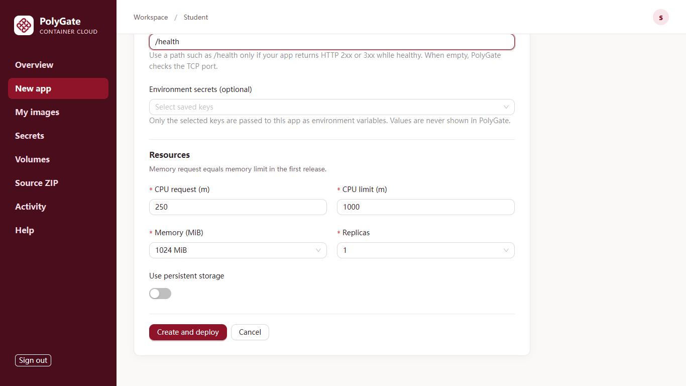

### Step 8 — Wait for Running and open the app

PolyGate returns to **Overview**. Scroll the main workspace to **Applications**. The new row moves through deployment states and should reach **Running**. Select **Open app** in that row. Its public URL is `https://apps.polylink.org/<app-id>/`; the app ID is the stable identifier, not the display name. On the sample page, select **Ask agent**; a local mock reply appears. This example uses no cloud model API and consumes no model tokens.

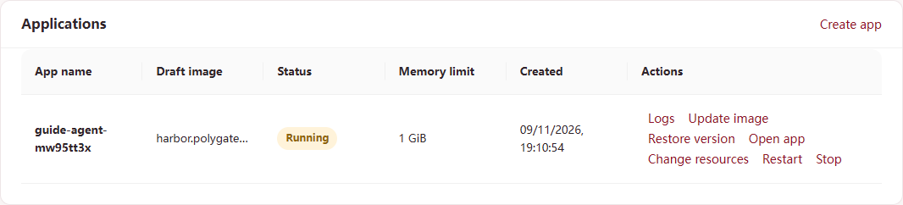

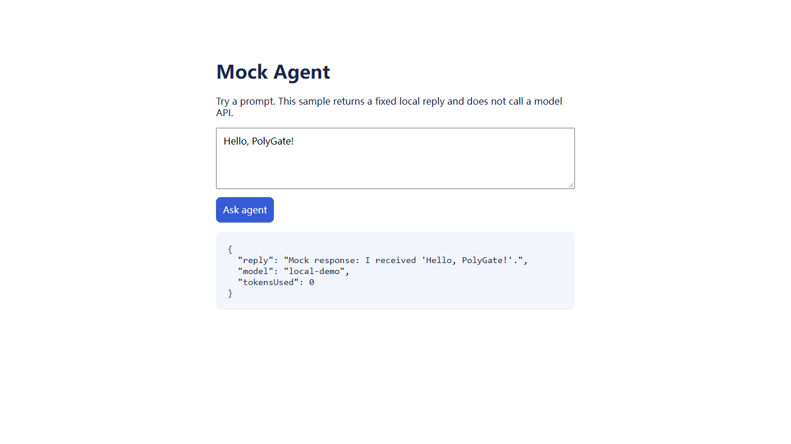

### Step 9 — Check logs and resource usage

Back on **Overview**, select **Logs** in the same app row. **Diagnostics** shows recent CPU and memory samples, current container logs, historical logs and events. The sample's `/health` requests appear in the current log. Close the dialog with the **×** in its upper right corner. If an app is not Running, check this dialog and the status before changing its configuration.

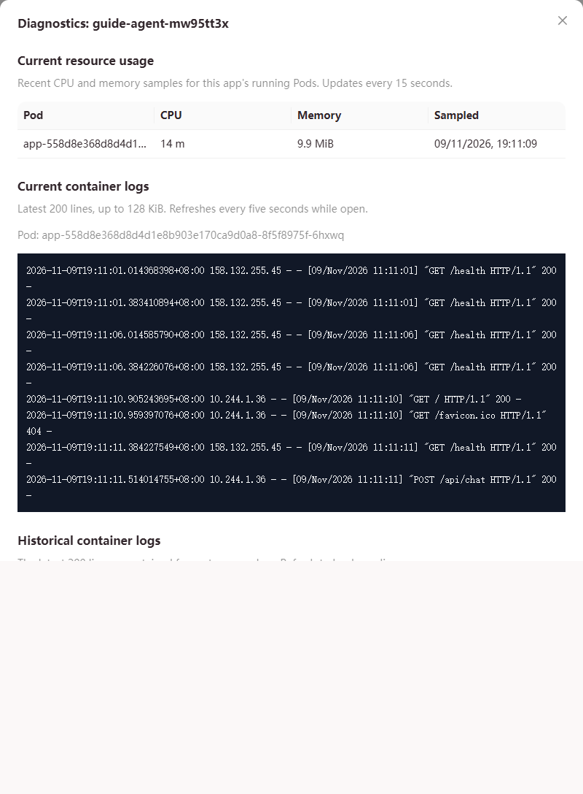

### Step 10 — Stop the test app

Select **Stop** on the app row. Check the confirmation text, then select **Stop** again in the small confirmation box. Wait for the row to show **Stopped**; cleanup of the Pod can take a short time. Stopping releases running capacity but keeps the app draft. For an app with a volume, stopping also keeps its volume and files.

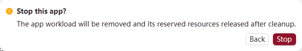

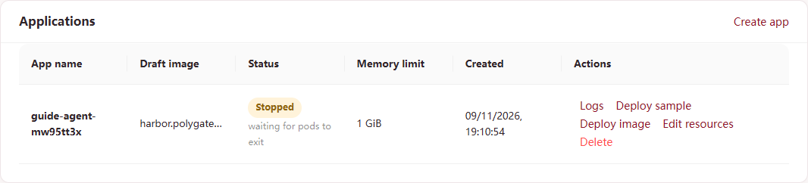

### Step 11 — Delete the app and remove its test image

Select **Delete** on the stopped app row, then **Delete** in the confirmation box. The app row disappears. If you also want to release the built image, open **My images**, find the image from this build, select **Remove**, and confirm **Remove**. Build history remains as a record, but the removed image can no longer be deployed. Never remove an image still used by an app.

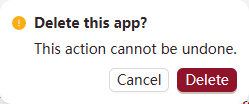

### Step 12 — Sign out

Select **Sign out** in the lower left. You should return to **Welcome to PolyGate** with a **Sign in** button. Signing out does not stop an app you chose to keep running.

## Use another sample or your own code

| Help download | Source ZIP build method | App port | Health path |
| --- | --- | ---: | --- |
| `mock-agent-python.zip` | Python template | 8000 | `/health` |
| `mock-counter-node.zip` | Node.js template | 3000 | `/health` |
| `mock-inspector-dockerfile.zip` | Use my Dockerfile | 8080 | `/health` |

For your own ZIP, place `main.py` at the root for the Python template, `package.json` and `package-lock.json` at the root for the Node.js template, or a `Dockerfile` at the root for **Use my Dockerfile**. Read your server's startup command or logs to find its real listening port, then enter that same number as **App port**. `EXPOSE` in a Dockerfile is a hint, not proof that the process listens there. Your process must listen on `0.0.0.0` at the app port you enter. Only set a health path if it returns HTTP 2xx or 3xx while your app is healthy.

To use a **prebuilt image** instead, open **My images**. Submit a public image reference with **Inspect image**, or select a local `docker save` `.tar` with **Upload image**. The tar must contain one `linux/amd64` image and be at most 1 GiB. Wait for **Approved**. High findings remain in the Trivy report but do not block deployment; Critical, Unknown or unrecognized findings do. For **Rejected**, use **View report** or **Download JSON** to inspect the findings. For **Failed**, use **View failure** to inspect and download the scan error summary; a failed scan has no vulnerability report. Open **New app**, save a draft with the image's actual listening port and resources, then on **Overview** choose **Deploy image** and select the approved image. For persistent files, first request a volume on **Volumes** and wait for **Ready**; then enable **Use persistent storage** in the app form and select that unused volume. A volume is limited to one app at a time and one running replica. The pilot has one online volume copy, so keep your own backup of important files.

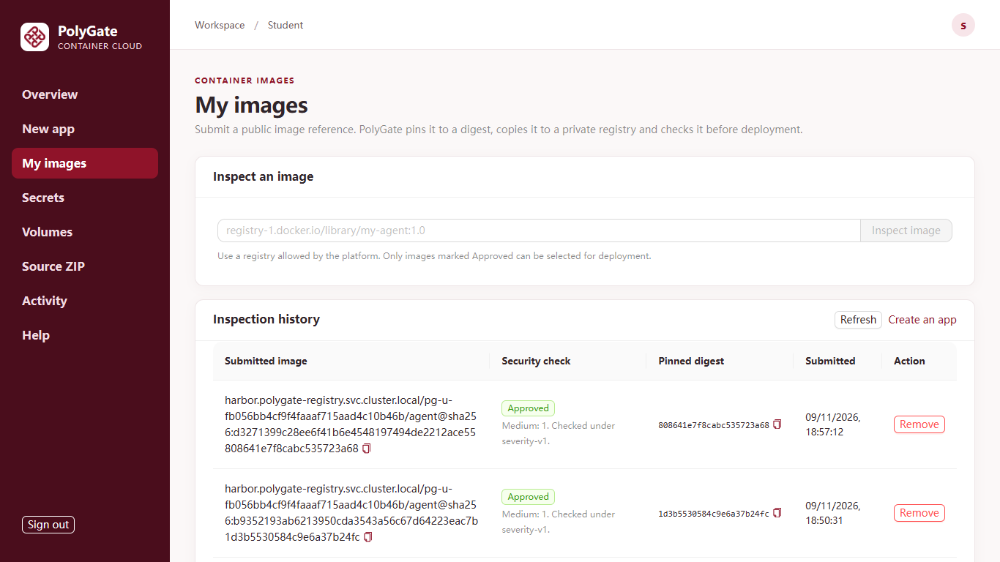

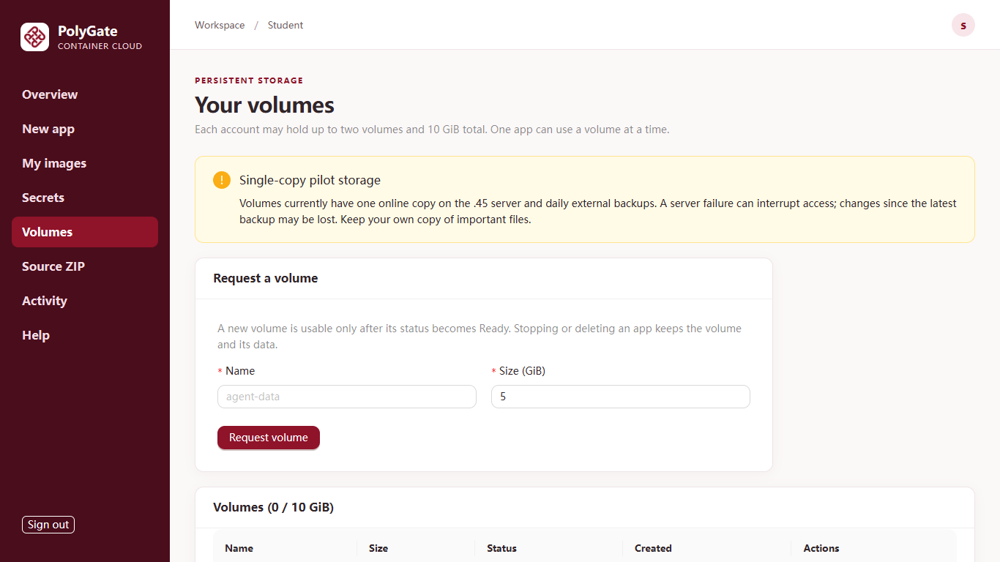

If a step fails, note the app name, build submission time and visible error, then check **Build history → View log** or **Overview → Logs**. Contact the laboratory operator with those details. Do not send passwords or API keys in screenshots or logs.

If the ZIP build succeeds but the app becomes **Failed** with `connection refused` events, check **App port**. The Python template uses **8000**, Node.js uses **3000**, and the Dockerfile sample uses **8080**. On **Overview**, choose **Edit port** for the failed app, enter the correct listening port, save, then choose **Deploy image** and select the same approved image. Leave the HTTP health path empty unless your app serves that path successfully. This keeps the app and its build history; you do not need to upload the ZIP again.

If **Logs** show `PermissionError` when Python imports code, the port may already be correct. PolyGate runs containers as UID/GID `65532` with a read-only root filesystem, even if the Dockerfile specifies another `USER`. Make code files and parent directories readable by UID `65532` (for example, add `RUN chmod -R a+rX /app` to your Dockerfile), and write temporary files under `/tmp` or a mounted volume. Build and submit the corrected image, then select **Deploy image** on the existing failed app.
