# PolyGate 学生全流程图文指南（中文版）

[English version](PolyGate_Student_Walkthrough_EN.md) · [三个示例项目源码](../examples/polygate-mock-projects/README.md)

本文按照一次真实浏览器操作，带你完成 **下载 Python 示例 ZIP → 上传构建 → 镜像审核 → 部署 → 访问作品 → 查看日志 → 停止 → 删除**。截图取自 2026 年 11 月 9 日的实验室内网试点，桌面浏览器尺寸为 1366 × 768。你看到的应用名称和时间会不同。平台按钮仍是英文；下文保留按钮原文，方便直接对照页面。本示例不需要云端模型 API Key。

## 开始前准备

- 连接实验室内网，用桌面浏览器打开 **<https://YOUR-POLYGATE-HOST/>**。
- 准备实验室管理员发给你的平台用户名和初始密码。不要使用别人的账号。
- 当前内网试点使用自签名证书。浏览器出现证书提示时，先核对地址确实是 `YOUR-POLYGATE-HOST`，再决定继续访问。
- 新账号第一次登录可能进入 Keycloak 的修改临时密码页面。按照页面要求设置新密码后，才会进入工作区。下面的截图使用已经完成首次改密的测试账号。
- 即使浏览器启用深色模式，登录表单也固定使用对比度清楚的 PolyGate 浅色配色。

## 按顺序完成一次源码 ZIP 测试

### 第 1 步：打开平台并登录

首页出现 **Welcome to PolyGate** 后，点击 **Sign in**。在下一个页面填写 **Username** 和 **Password**，再点击 **Sign In**。如果又回到登录页，先检查用户名密码；仍无法登录时请联系实验室管理员重置。

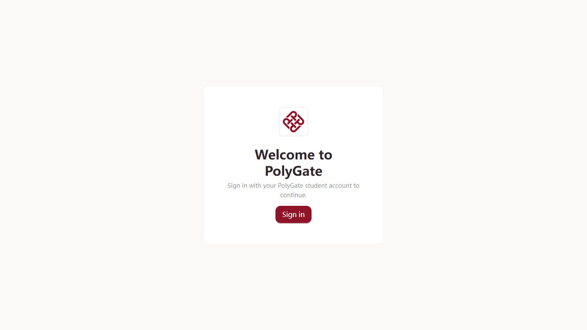

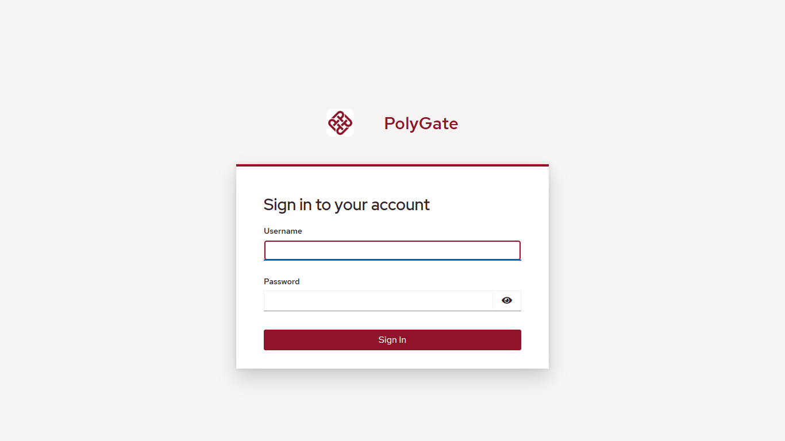

### 第 2 步：认识工作区与配额

登录成功后应看到 **Your workspace**。**Overview** 显示账号已配置资源和剩余额度；草稿和已停止的应用也会占用配置额度。左侧有 **Help**、**Source ZIP**、**My images**、**Volumes** 等入口。账号可同时配置多少应用，以你自己的页面显示为准。

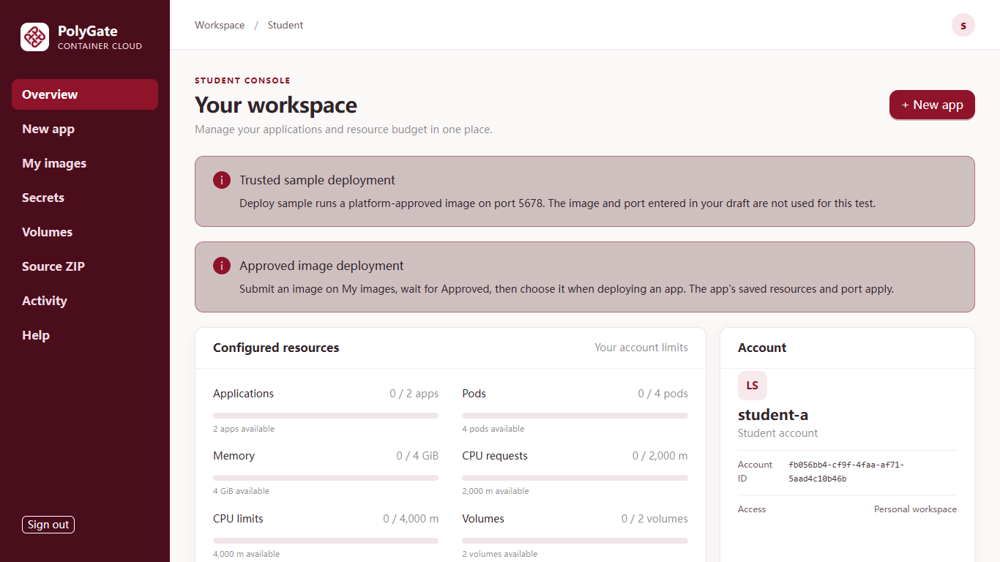

### 第 3 步：下载示例 ZIP

点击左侧 **Help**。找到 **Download a sample project**，点击 **Mock Agent (Python ZIP)**，浏览器会下载 `mock-agent-python.zip`。上传前**不要解压**。同一位置还有 Node.js 计数器和 Dockerfile 请求展示器；对应构建方式和端口也列在页面上。

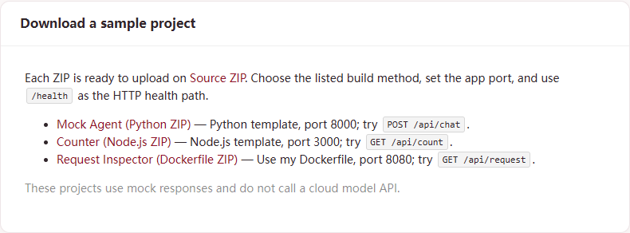

### 第 4 步：选择正确的构建方式

点击左侧 **Source ZIP**，在 **Build method** 下拉框选择 **Python template**。这个示例的 `main.py` 位于 ZIP 根目录，应用监听 `0.0.0.0:8000`。如果选的是另外两个示例，请使用文末表格中对应的构建方式和端口。

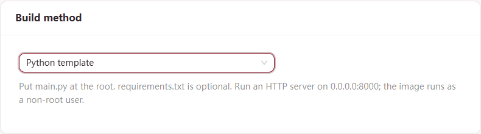

### 第 5 步：上传并提交构建

点击 **Browse ZIP...**，选中刚下载的 `mock-agent-python.zip`。确认页面出现 **Selected: mock-agent-python.zip**，再点击一次 **Queue build**。ZIP 压缩后不能超过 100 MiB，解压后不能超过 1 GiB。提交上传时暂时不要刷新页面。

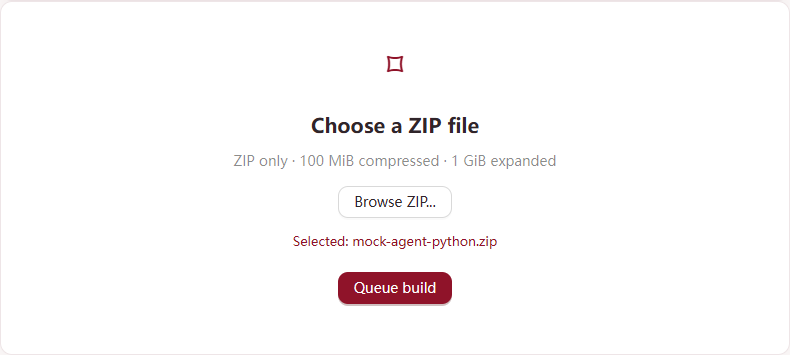

### 第 6 步：等待构建与镜像审核

在 **Build history** 找到最新一行。状态先是 **Queued**，可能经过 **Building**，成功后变成 **Succeeded**。页面会自动刷新，也可以点击 **Refresh**。截图中还有历史测试记录，请根据最新提交时间认准自己的这一行。

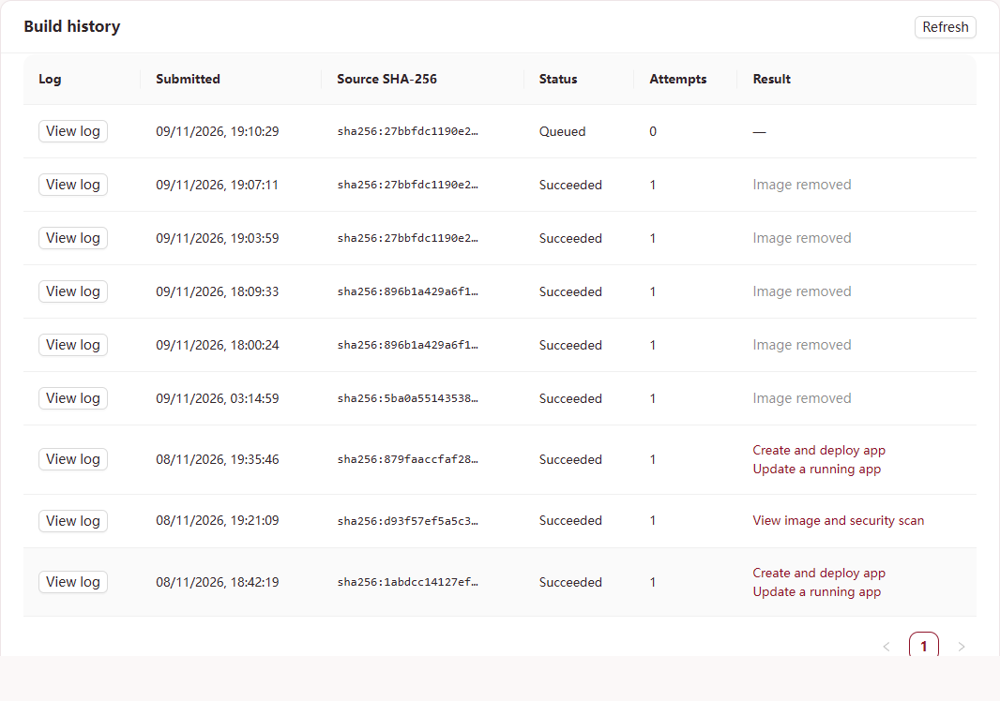

点击该行的 **View log** 可查看构建输出。构建失败时先看这里的错误。构建成功后还要等待镜像安全扫描；结果栏出现 **Create and deploy app** 才能继续。如果暂时只显示 **View image and security scan**，到 **My images** 等待 **Approved**；被拒绝的镜像不能部署。

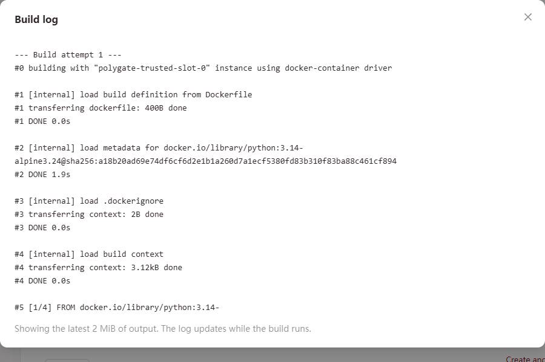

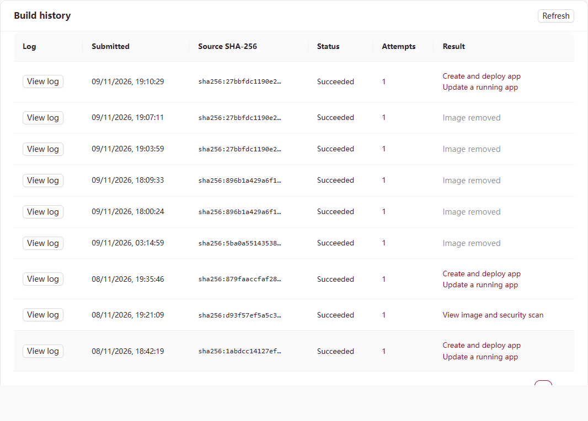

### 第 7 步：填写应用信息并部署

点击成功构建那一行的 **Create and deploy app**。新页面顶部应显示 **Approved build selected**。填写一个未使用过、由小写字母和数字等组成的 **App name**，例如 `my-mock-agent`。镜像引用由平台自动填入，不用修改。**App port** 填 `8000`，**HTTP health path** 填 `/health`。

**App port 是容器内 HTTP 程序实际监听的端口。** 这个 Python 示例监听 `8000`，所以只填数字 `8000`；不要填 URL、浏览器的 HTTPS 端口或宿主机端口。程序必须监听该端口的 `0.0.0.0`，只监听 `127.0.0.1` 时平台无法访问。示例提供 `/health`，所以可以填写；自己的项目若没有在健康时返回 HTTP 2xx 或 3xx 的接口，就把 **HTTP health path** 留空。

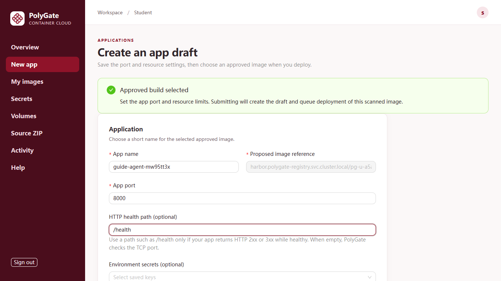

第一次测试可保持默认资源：**CPU request** 为 `250 m`，**CPU limit** 为 `1000 m`，**Memory** 为 `1024 MiB`，**Replicas** 为 `1`，**Use persistent storage** 关闭。在中间工作区向下滚动，点击一次 **Create and deploy**。平台会建立草稿并排队部署。单容器内存最多可选 4096 MiB（4 GiB），但账号和集群总额度仍会限制能否部署。

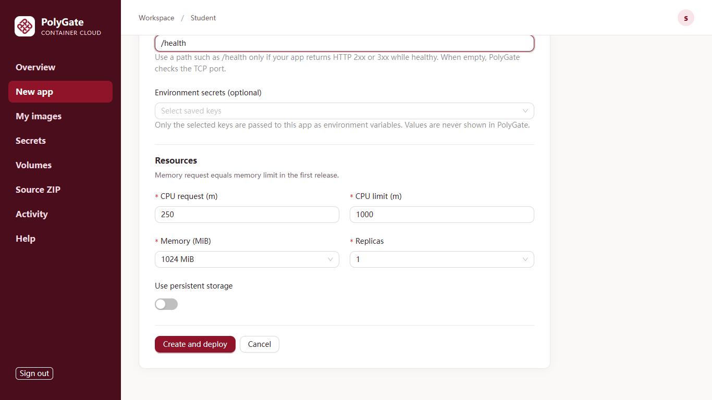

### 第 8 步：等待 Running，打开作品

页面回到 **Overview** 后，在中间工作区向下滚动到 **Applications**。新应用状态会逐步变化，最终应显示 **Running**。在同一行点击 **Open app**。示例页面打开后点击 **Ask agent**，下方会出现本地生成的模拟回复；不会调用云端模型，也不会产生模型 token 费用。

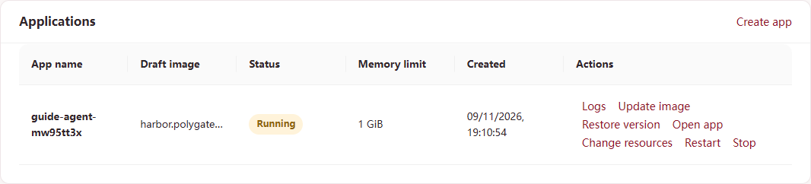

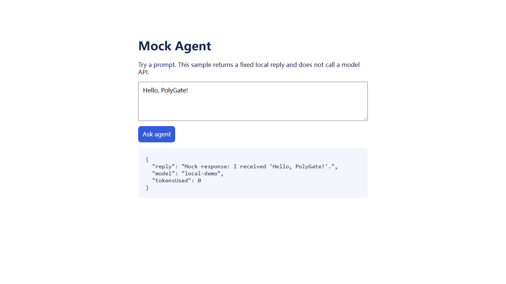

### 第 9 步：查看日志和资源用量

返回 PolyGate 的 **Overview**，在该应用行点击 **Logs**。**Diagnostics** 窗口包含最近 CPU、内存采样，当前容器日志、历史日志和事件。示例的 `/health` 请求会出现在当前日志里。看完点击窗口右上角 **×**。若应用一直没有变为 Running，先看状态和这个窗口里的报错，再修改配置。

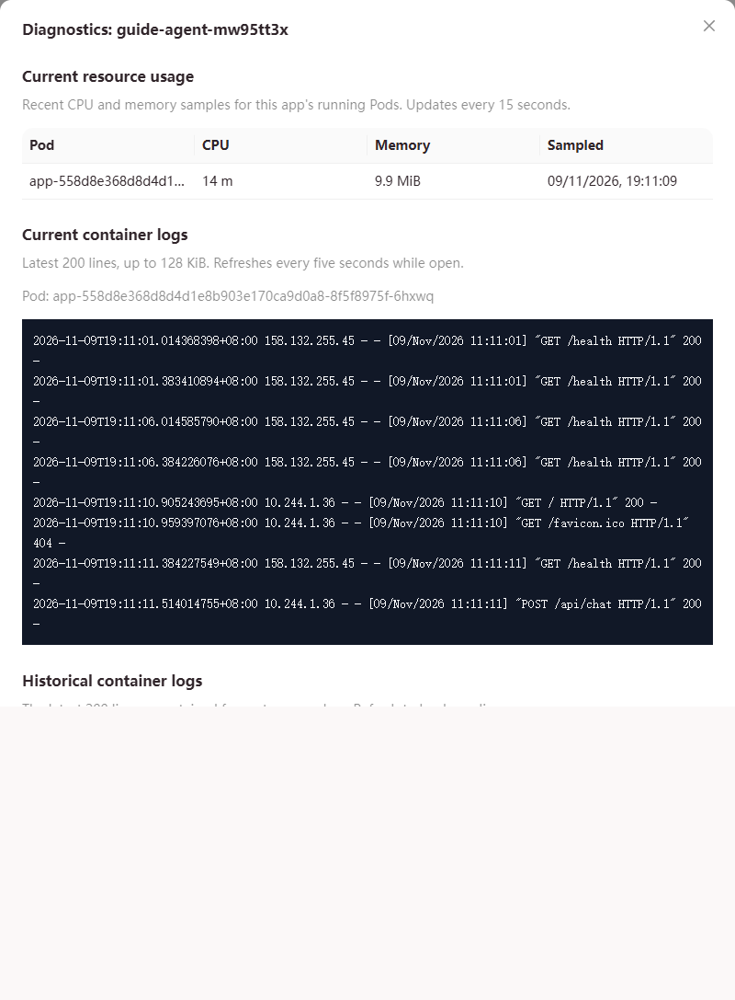

### 第 10 步：停止测试应用

点击该行的 **Stop**。核对确认框文字后，再点击框内的 **Stop**。等待状态显示 **Stopped**；Pod 清理可能需要片刻。停止会释放运行容量，但保留应用草稿；若应用挂载了卷，卷及文件也会保留。

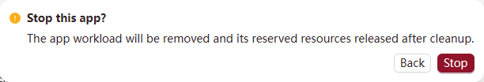

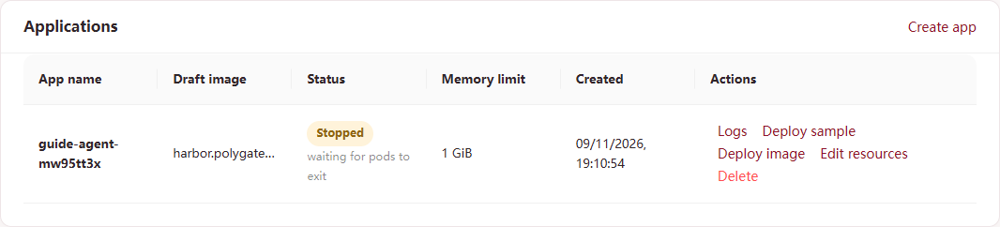

### 第 11 步：删除应用及测试镜像

在已停止应用那一行点击 **Delete**，再在确认框中点击 **Delete**。应用行会消失。如果还想回收这次构建的镜像，打开 **My images**，找到对应镜像，点击 **Remove** 并再次确认。构建历史会保留，但已移除的镜像不能再部署。正在被应用使用的镜像不能移除。

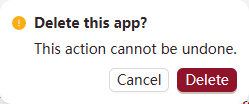

### 第 12 步：退出账号

点击左下角 **Sign out**。页面应回到带有 **Sign in** 按钮的欢迎页。退出登录不会停止你有意保留运行的应用。

## 换用其他示例或自己的源码

| Help 中的 ZIP | Source ZIP 构建方式 | App port | 健康检查路径 |
| --- | --- | ---: | --- |
| `mock-agent-python.zip` | Python template | 8000 | `/health` |
| `mock-counter-node.zip` | Node.js template | 3000 | `/health` |
| `mock-inspector-dockerfile.zip` | Use my Dockerfile | 8080 | `/health` |

提交自己的源码时：Python 模板的 `main.py`、Node.js 模板的 `package.json` 和 `package-lock.json`、或自定义方式的 `Dockerfile` 必须在 ZIP 根目录。先看程序启动命令或日志，确认实际监听端口，再把同一个数字填进 **App port**。Dockerfile 的 `EXPOSE` 只是声明，不能证明程序确实监听该端口。程序应监听 `0.0.0.0` 和表单里填的端口。只有应用健康时真正返回 HTTP 2xx 或 3xx，才填写 HTTP 健康检查路径。

如果已有**预构建镜像**：进入 **My images**，可以填写公开镜像引用并点击 **Inspect image**，也可以点击 **Upload image** 上传本机 `docker save` 生成的 `.tar`。归档最多 1 GiB，须包含一张 `linux/amd64` 镜像。等到 **Approved**。High 漏洞仍显示在 Trivy 报告中，但不阻止部署；Critical、Unknown 或无法识别的严重度会阻止部署。若显示 **Rejected**，可用 **View report** 查看或 **Download JSON** 下载漏洞报告；若显示 **Failed**，可点 **View failure** 查看并下载扫描错误摘要，此时没有漏洞报告。然后进入 **New app**，按镜像内程序的真实监听端口和资源创建草稿；到 **Overview** 点 **Deploy image**，选择刚批准的镜像。若需要持久化文件，先到 **Volumes** 申请卷并等到 **Ready**，再在应用表单启用 **Use persistent storage**，选择未占用的卷。一个卷同一时间只能用于一个应用、一个运行副本。试点卷目前只有一个在线副本，重要文件请另外保留备份。

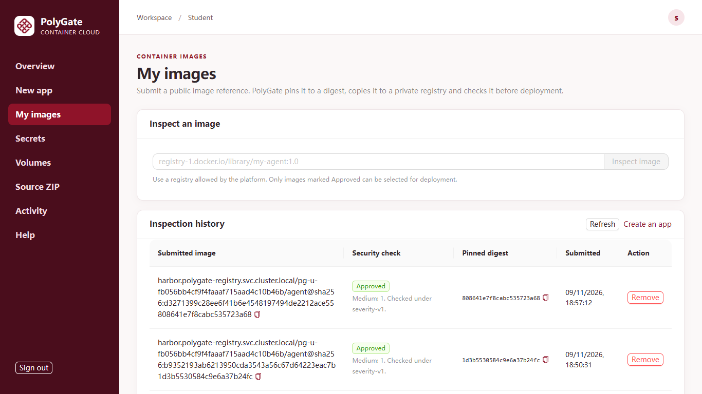

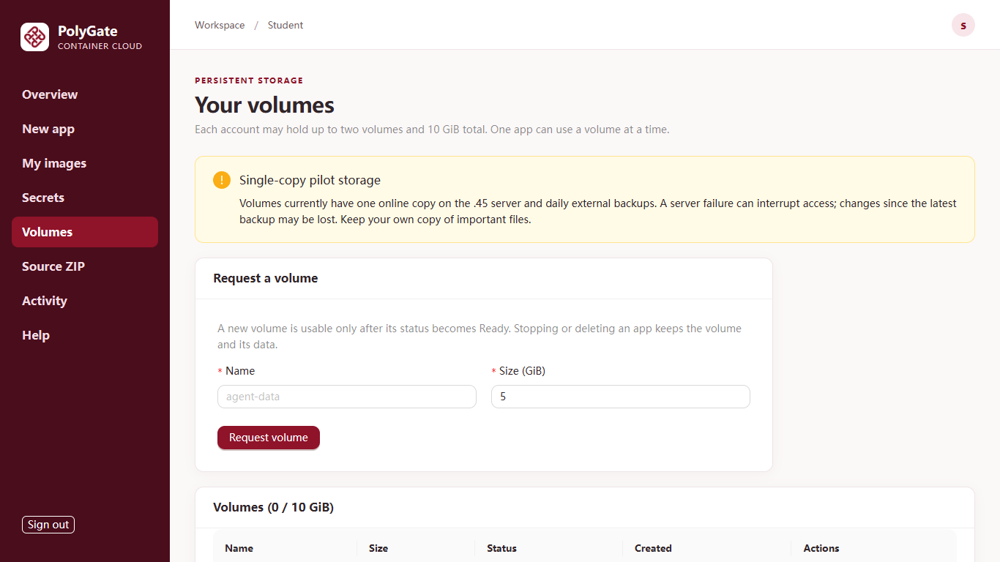

若任一步失败，记下应用名、提交时间和页面错误，到 **Build history → View log** 或 **Overview → Logs** 查看，再把这些信息交给实验室管理员。不要把密码或 API Key 放进截图、源码或日志。

如果 ZIP 构建成功，但应用显示 **Failed**，事件里有 `connection refused`，先核对 **App port**：Python 模板是 **8000**，Node.js 模板是 **3000**，Dockerfile 示例是 **8080**。在 **Overview** 找到失败应用，点击 **Edit port**，填入程序实际监听的端口并保存；随后点击 **Deploy image**，选择同一张已批准镜像重新部署。除非应用确实提供对应接口，否则 HTTP 健康检查路径先留空。这样可以保留原应用和构建记录，不必重新上传 ZIP。

如果 **Logs** 显示 Python 导入代码时发生 `PermissionError`，端口可能本来就是正确的。PolyGate 固定用 UID/GID `65532` 运行容器，并把根文件系统设为只读；Dockerfile 中的 `USER` 不会覆盖平台设置。应让该 UID 能读取代码和父目录（例如在 Dockerfile 加 `RUN chmod -R a+rX /app`），临时文件写到 `/tmp`，持久数据写到挂载卷。修正镜像后，在原先失败的应用上重新选择 **Deploy image**。
